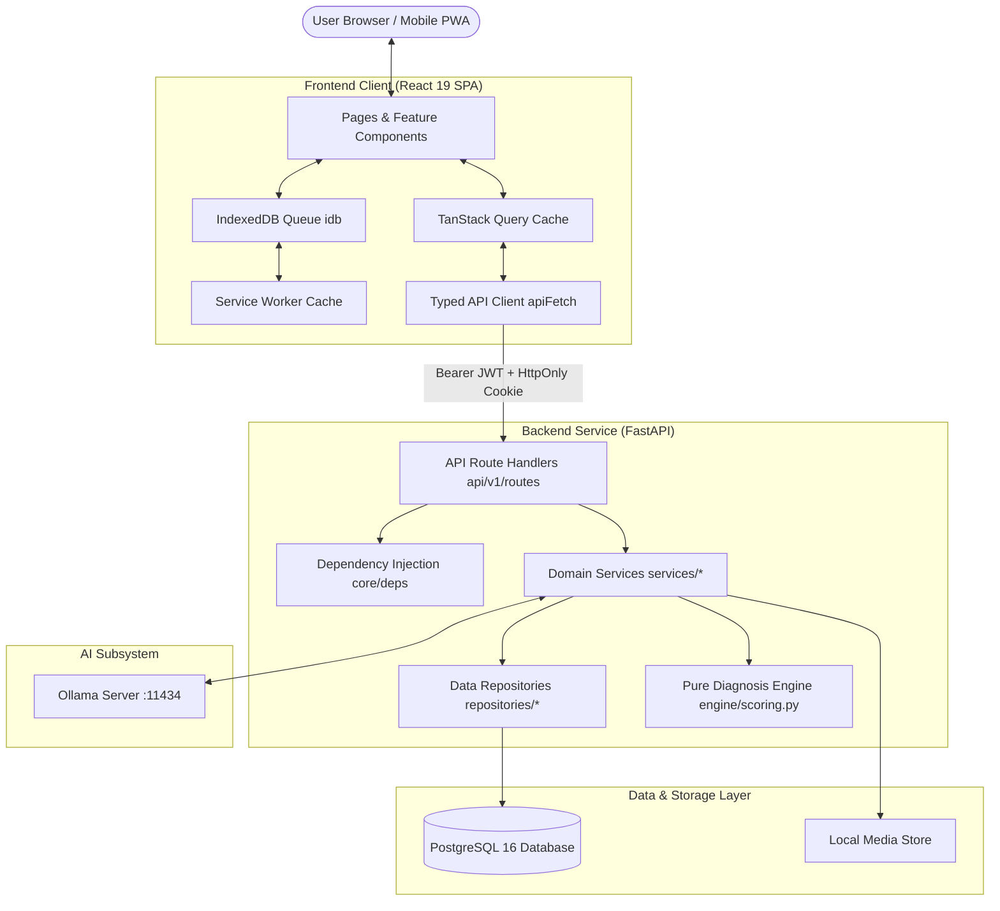

# Architectural Design & Layering Contracts

## 1. System Architecture Overview

The Sunflower Expert System follows a strictly decoupled client-server architecture with an explicit HTTP boundary at `/api/v1/*`.



---

## 2. Architectural Layering Rules

The backend architecture strictly enforces a unidirectional dependency hierarchy:

| Layer | Directory | Permitted Imports | Prohibited Imports | Responsibility |
| :--- | :--- | :--- | :--- | :--- |
| **API Routes** | `app/api/v1/routes/` | `schemas`, `services`, `core.deps` | SQLAlchemy `select()`, raw SQL, ORM `models` | HTTP parameter parsing, validation, status codes, route docs |
| **Services** | `app/services/` | `repositories`, `schemas`, `core`, `engine` | FastAPI types (`Request`, `Depends`, `HTTPException`) | Business logic coordination, transaction boundaries, audits |
| **Pure Engine** | `app/services/engine/scoring.py` | Python standard library ONLY (`math`, `dataclasses`, `typing`) | `app.db`, `app.models`, async calls, network I/O | Pure mathematical scoring, Bayesian weighting, deterministic testability |
| **Repositories** | `app/repositories/` | `models`, `db.session`, SQLAlchemy | `schemas`, `services`, FastAPI | Database queries, joins, prefetching, aggregations |
| **Models** | `app/models/` | `db.base`, SQLAlchemy ORM | `services`, `schemas`, `repositories` | Relational table schemas, foreign keys, relationships |

### Why `scoring.py` is Isolated:
`scoring.py` contains zero imports from database packages or async frameworks. It accepts plain immutable dataclasses (`DiseaseRule`, `SymptomWeight`, `EngineParams`, `answers`) and returns `DiseaseScore`. This enables millisecond-level execution of golden unit tests without database spin-up, preventing weight regressions and logic drifts.

---

## 3. Core Engine Mechanics

The diagnosis engine evaluates candidate diseases through a weighted Bayesian evidence model configured dynamically via `rulesets.params`:

### 3.1 Scoring Formula
For candidate disease $D$ with defined symptom weights $w(s) \in [0, 1]$:
$$\text{present} = \sum_{s \in D, \text{ ans}(s) = \text{"yes"}} w(s)$$
$$\text{absent} = \sum_{s \in D, \text{ ans}(s) = \text{"no"}} w(s)$$
$$\text{possible} = \sum_{s \in D} w(s)$$

$$\text{raw} = \frac{\text{present} - \lambda_{\text{absent}} \cdot \text{absent}}{\text{possible}} \quad (\text{if possible } = 0, \text{ raw } = 0.0)$$
$$\text{score} = \text{clamp}(\text{raw}, 0.0, 1.0)$$

### 3.2 Clinical Rule Modifiers
1. **Pathognomonic Floor**:
   If any symptom marked `is_pathognomonic = True` is answered `"yes"`:
   $$\text{score} = \max(\text{score}, \text{pathognomonic\_floor}) \quad (\text{default: } 0.85)$$
2. **Mandatory Missing Constraint**:
   If any symptom marked `is_required = True` is answered `"no"`:
   $$\text{score} = \text{score} \times \text{required\_missing\_penalty} \quad (\text{default: } 0.25)$$

### 3.3 Confidence Normalization
Candidates with $\text{score} < \text{min\_confidence}$ (default: $0.35$) are pruned. Remaining candidates are sorted by score descending (with slug tie-breaking). Confidence is normalized across retained candidates:
$$\text{confidence}_i = \frac{\text{score}_i}{\sum_{j \in \text{retained}} \text{score}_j}$$

### 3.4 Shannon Entropy Information Gain (`next_best_questions`)
To avoid requiring growers to answer 60+ questions, the engine calculates the Shannon entropy $H(C)$ across current candidates:
$$H(C) = - \sum_{i} p_i \log_2(p_i)$$
For each unanswered symptom present across more than one candidate rule, the engine simulates answering `"yes"` and `"no"`, computes the expected posterior entropy $E[H]$, and ranks symptoms by information gain:
$$\text{Gain}(s) = H(C) - E[H(C \mid s)]$$
The top $k=3$ symptoms are returned to the frontend as the next best discriminative questions.

---

## 4. Cross-Cutting Concerns

### 4.1 Error Protocol: RFC 7807 Problem Details
All API errors return `application/problem+json` with consistent structure:
```json
{
  "type": "/errors/not-found",
  "title": "Not Found",
  "status": 404,
  "detail": "Disease with slug 'unknown' was not found",
  "errors": []
}
```

### 4.2 Security & Authentication
- **Access Tokens**: Short-lived JWTs (default: 30 minutes) carried in the `Authorization: Bearer <token>` header.
- **Refresh Tokens**: Long-lived tokens (default: 7 days) stored in an `HttpOnly`, `SameSite=Lax` cookie (`refresh_token`).
- **Rotation**: Calling `/api/v1/auth/refresh` invalidates the old token family and issues a fresh pair.
- **Fail-Closed RBAC**: `require_permission(code)` verifies the user's role against `role_permissions`. Any uncaught error or database failure during access checks fails closed by throwing HTTP 403 Forbidden.

### 4.3 Multilingual Translations Architecture
Rather than creating wide columns (`name_en`, `name_km`, `description_en`, `description_km`) or separate localized databases, content is stored in a single unified table:
```sql
translations(entity_type, entity_id, locale, field, value)
```
When querying in Khmer (`km`), the repository executes a join or prefetch. If a translation row is absent, it falls back field-by-field to English (`en`).
