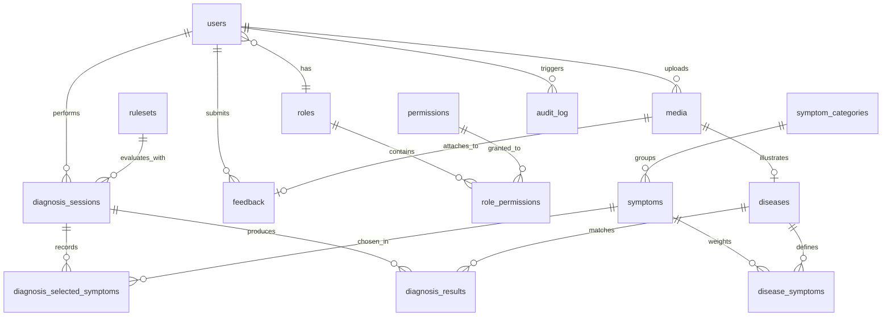

# Database Schema & Relational Models

## 1. Entity-Relationship Architecture

---

## 2. Table Specifications & Constraints

### 2.1 Identity & Access Control

#### `roles`
- `id`: `INTEGER PRIMARY KEY GENERATED ALWAYS AS IDENTITY`
- `name`: `VARCHAR(64) UNIQUE NOT NULL` (e.g., `grower`, `agronomist`, `admin`)
- `description`: `TEXT NULL`

#### `permissions`
- `id`: `INTEGER PRIMARY KEY GENERATED ALWAYS AS IDENTITY`
- `code`: `VARCHAR(64) UNIQUE NOT NULL INDEX` (e.g., `disease:create`, `diagnosis:run`)
- `description`: `VARCHAR(255) NULL`

#### `role_permissions`
- `role_id`: `INTEGER NOT NULL REFERENCES roles(id) ON DELETE CASCADE`
- `permission_id`: `INTEGER NOT NULL REFERENCES permissions(id) ON DELETE CASCADE`
- **Primary Key**: `(role_id, permission_id)`

#### `users`
- `id`: `INTEGER PRIMARY KEY GENERATED ALWAYS AS IDENTITY`
- `email`: `VARCHAR(255) UNIQUE NOT NULL INDEX`
- `username`: `VARCHAR(64) UNIQUE NOT NULL INDEX`
- `password_hash`: `VARCHAR(255) NOT NULL` (Argon2id or legacy hash)
- `role_id`: `INTEGER NOT NULL REFERENCES roles(id)`
- `is_active`: `BOOLEAN NOT NULL DEFAULT TRUE`
- `created_at`: `TIMESTAMP WITH TIME ZONE NOT NULL DEFAULT NOW()`
- `updated_at`: `TIMESTAMP WITH TIME ZONE NOT NULL DEFAULT NOW()`

---

### 2.2 Botanical Knowledge Base

#### `symptom_categories`
- `id`: `INTEGER PRIMARY KEY GENERATED ALWAYS AS IDENTITY`
- `code`: `VARCHAR(64) UNIQUE NOT NULL INDEX` (e.g., `leaf`, `stem`, `head`, `whole_plant`)
- `sort_order`: `INTEGER NOT NULL DEFAULT 0`

#### `symptoms`
- `id`: `INTEGER PRIMARY KEY GENERATED ALWAYS AS IDENTITY`
- `code`: `VARCHAR(64) UNIQUE NOT NULL INDEX` (e.g., `yellow_spots`, `white_pustules`)
- `category_id`: `INTEGER NOT NULL REFERENCES symptom_categories(id)`
- `is_environmental`: `BOOLEAN NOT NULL DEFAULT FALSE`
- `created_by_id`: `INTEGER NULL REFERENCES users(id) ON DELETE SET NULL`
- `updated_by_id`: `INTEGER NULL REFERENCES users(id) ON DELETE SET NULL`
- `created_at`: `TIMESTAMP WITH TIME ZONE NOT NULL DEFAULT NOW()`
- `updated_at`: `TIMESTAMP WITH TIME ZONE NOT NULL DEFAULT NOW()`

#### `diseases`
- `id`: `INTEGER PRIMARY KEY GENERATED ALWAYS AS IDENTITY`
- `slug`: `VARCHAR(128) UNIQUE NOT NULL INDEX` (e.g., `downy-mildew`)
- `pathogen_type`: `ENUM('fungal', 'bacterial', 'viral', 'abiotic', 'other') NOT NULL`
- `image_media_id`: `INTEGER NULL REFERENCES media(id) ON DELETE SET NULL`
- `is_published`: `BOOLEAN NOT NULL DEFAULT FALSE`
- `search_vector`: `TSVECTOR NULL` (PostgreSQL full-text search index)
- `created_by_id`: `INTEGER NULL REFERENCES users(id) ON DELETE SET NULL`
- `updated_by_id`: `INTEGER NULL REFERENCES users(id) ON DELETE SET NULL`
- `created_at`: `TIMESTAMP WITH TIME ZONE NOT NULL DEFAULT NOW()`
- `updated_at`: `TIMESTAMP WITH TIME ZONE NOT NULL DEFAULT NOW()`

#### `disease_symptoms` (Knowledge Base Rules & Associations)
- `disease_id`: `INTEGER NOT NULL REFERENCES diseases(id) ON DELETE CASCADE`
- `symptom_id`: `INTEGER NOT NULL REFERENCES symptoms(id) ON DELETE CASCADE`
- `weight`: `NUMERIC(3, 2) NOT NULL`
- `is_required`: `BOOLEAN NOT NULL DEFAULT FALSE`
- `is_pathognomonic`: `BOOLEAN NOT NULL DEFAULT FALSE`
- **Primary Key**: `(disease_id, symptom_id)`
- **Check Constraint**: `CHECK (weight >= 0.00 AND weight <= 1.00)`

---

### 2.3 Multilingual Translations

#### `translations`
- `entity_type`: `VARCHAR(64) NOT NULL` (`disease`, `symptom`, `category`)
- `entity_id`: `INTEGER NOT NULL`
- `locale`: `VARCHAR(10) NOT NULL` (`en`, `km`)
- `field`: `VARCHAR(64) NOT NULL` (`name`, `description`, `cause`, `treatment`, `prevention`, `label`)
- `value`: `TEXT NOT NULL`
- **Primary Key**: `(entity_type, entity_id, locale, field)`
- **Composite Index**: `ix_translations_lookup (entity_type, entity_id, locale)`

---

### 2.4 Diagnostic Evaluation & Telemetry

#### `rulesets`
- `id`: `INTEGER PRIMARY KEY GENERATED ALWAYS AS IDENTITY`
- `version`: `VARCHAR(64) UNIQUE NOT NULL INDEX` (e.g., `2026.09.1`)
- `algorithm`: `VARCHAR(64) NOT NULL` (e.g., `weighted_evidence_v1`)
- `params`: `JSONB NOT NULL` (`{"lambda_absent": 0.5, "min_confidence": 0.35, "pathognomonic_floor": 0.85, "required_missing_penalty": 0.25}`)
- `is_active`: `BOOLEAN NOT NULL DEFAULT FALSE`
- `published_at`: `TIMESTAMP WITH TIME ZONE NULL`
- `published_by_id`: `INTEGER NULL REFERENCES users(id) ON DELETE SET NULL`
- **Partial Unique Index**: `uq_rulesets_single_active UNIQUE (is_active) WHERE is_active = TRUE` (guarantees at most one active ruleset).

#### `diagnosis_sessions`
- `id`: `UUID PRIMARY KEY DEFAULT gen_random_uuid()`
- `user_id`: `INTEGER NULL REFERENCES users(id) ON DELETE SET NULL`
- `ruleset_id`: `INTEGER NOT NULL REFERENCES rulesets(id)`
- `locale`: `VARCHAR(10) NOT NULL DEFAULT 'en'`
- `symptom_count`: `INTEGER NOT NULL DEFAULT 0`
- `top_disease_id`: `INTEGER NULL REFERENCES diseases(id) ON DELETE SET NULL`
- `top_confidence`: `NUMERIC(4, 3) NULL`
- `outcome`: `ENUM('matched', 'no_match') NOT NULL`
- `created_at`: `TIMESTAMP WITH TIME ZONE NOT NULL DEFAULT NOW()`
- **Index**: `ix_diagnosis_sessions_user_created (user_id, created_at DESC)`

#### `diagnosis_selected_symptoms`
- `session_id`: `UUID NOT NULL REFERENCES diagnosis_sessions(id) ON DELETE CASCADE`
- `symptom_id`: `INTEGER NOT NULL REFERENCES symptoms(id) ON DELETE CASCADE`
- `answer`: `ENUM('yes', 'no', 'unknown') NOT NULL`
- **Primary Key**: `(session_id, symptom_id)`

#### `diagnosis_results`
- `id`: `INTEGER PRIMARY KEY GENERATED ALWAYS AS IDENTITY`
- `session_id`: `UUID NOT NULL REFERENCES diagnosis_sessions(id) ON DELETE CASCADE`
- `rank`: `INTEGER NOT NULL`
- `disease_id`: `INTEGER NULL REFERENCES diseases(id) ON DELETE SET NULL`
- `disease_name_snapshot`: `VARCHAR(255) NOT NULL`
- `score`: `NUMERIC(4, 3) NOT NULL`
- `confidence`: `NUMERIC(4, 3) NOT NULL`
- `evidence`: `JSONB NOT NULL` (`{"supporting": [...], "against": [...], "missing_key": [...]}`)
- **Index**: `ix_diagnosis_results_session (session_id, rank)`

---

### 2.5 Media, Feedback, & Auditing

#### `feedback`
- `id`: `INTEGER PRIMARY KEY GENERATED ALWAYS AS IDENTITY`
- `user_id`: `INTEGER NULL REFERENCES users(id) ON DELETE SET NULL`
- `diagnosis_session_id`: `UUID NULL REFERENCES diagnosis_sessions(id) ON DELETE SET NULL`
- `subject`: `VARCHAR(255) NOT NULL`
- `message`: `TEXT NOT NULL`
- `media_id`: `INTEGER NULL REFERENCES media(id) ON DELETE SET NULL`
- `status`: `ENUM('open', 'in_review', 'resolved') NOT NULL DEFAULT 'open'`
- `created_at`: `TIMESTAMP WITH TIME ZONE NOT NULL DEFAULT NOW()`
- **Index**: `ix_feedback_status_created (status, created_at)`

#### `media`
- `id`: `INTEGER PRIMARY KEY GENERATED ALWAYS AS IDENTITY`
- `storage_key`: `VARCHAR(255) UNIQUE NOT NULL INDEX`
- `mime_type`: `VARCHAR(128) NOT NULL`
- `bytes`: `INTEGER NOT NULL`
- `width`: `INTEGER NULL`
- `height`: `INTEGER NULL`
- `uploaded_by_id`: `INTEGER NULL REFERENCES users(id) ON DELETE SET NULL`
- `created_at`: `TIMESTAMP WITH TIME ZONE NOT NULL DEFAULT NOW()`

#### `audit_log`
- `id`: `INTEGER PRIMARY KEY GENERATED ALWAYS AS IDENTITY`
- `actor_id`: `INTEGER NULL REFERENCES users(id) ON DELETE SET NULL`
- `action`: `VARCHAR(64) NOT NULL INDEX`
- `entity_type`: `VARCHAR(64) NOT NULL INDEX`
- `entity_id`: `INTEGER NULL`
- `diff`: `JSONB NULL`
- `created_at`: `TIMESTAMP WITH TIME ZONE NOT NULL DEFAULT NOW()`
