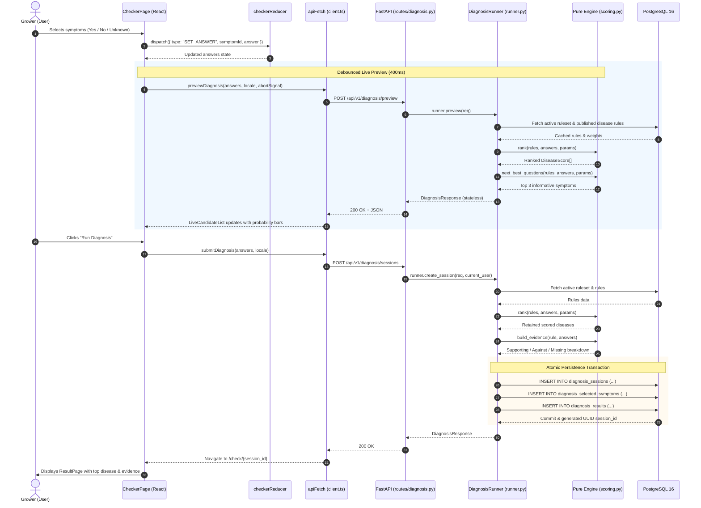
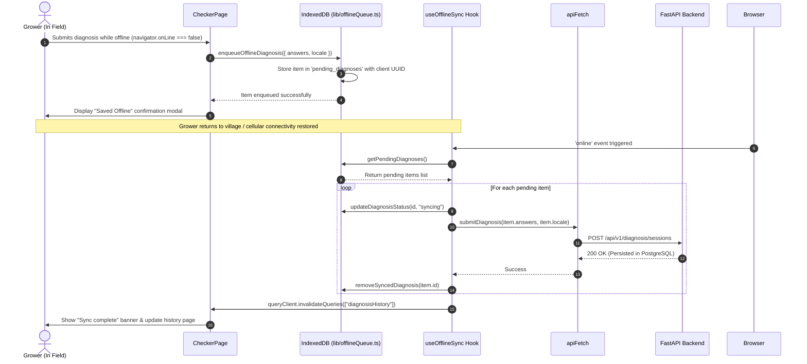
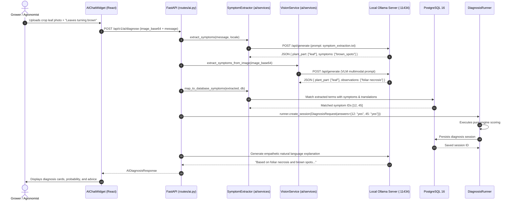
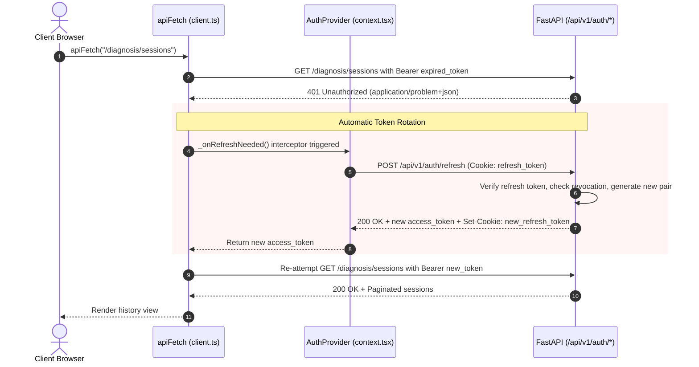

# Data Flow & Transaction Lifecycles

## 1. Flow 1: Interactive Symptom Diagnosis Workflow

This is the central grower workflow from symptom selection through real-time preview to persistent result generation.

---

## 2. Flow 2: Offline Diagnosis Queuing and Resynchronization

When field internet drops, the system transitions gracefully into offline mode.

---

## 3. Flow 3: AI Multimodal Symptom Extraction & Expert Diagnosis

---

## 4. Flow 4: Authentication & Silent Token Refresh Loop

